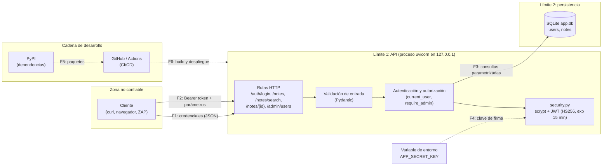

# Fase 1: Caracterización, amenazas y requisitos de seguridad

Aplicación evaluada: API REST de notas por usuario (FastAPI + SQLite), versión `secure/`. La versión `vulnerable/` se usa solo para mostrar el estado previo a la remediación.

## 1. Arquitectura y límites de confianza

**Activos**

| ID | Activo | Dónde vive |
|---|---|---|
| A1 | Notas de los usuarios (confidencialidad) | tabla `notes` |
| A2 | Credenciales (hashes) y roles | tabla `users` |
| A3 | Clave de firma JWT | variable `APP_SECRET_KEY` |
| A4 | Tokens de sesión | cliente, cabecera `Authorization` |
| A5 | Integridad del código y de las dependencias | repositorio, PyPI, CI |

**Límites de confianza.** El cliente nunca es confiable: todo lo que llega por F1 y F2 se valida en el servidor. La base de datos solo recibe consultas desde la capa de autorización de la API. Los componentes externos en tiempo de ejecución son ninguno; en desarrollo, PyPI y GitHub Actions entran al proceso de construcción.

## 2. Matriz de amenazas

| ID | Amenaza | Activo | Condición de riesgo | Impacto | Riesgo | Control propuesto |
|---|---|---|---|---|---|---|
| T1 | Acceso a notas ajenas (BOLA/IDOR) | A1 | `/notes/{id}` devuelve la nota sin comparar `owner_id` con el usuario autenticado | Lectura de notas privadas de cualquier usuario cambiando el ID | Alto | Verificar propiedad del recurso en cada lectura (R1) |
| T2 | Inyección SQL en la búsqueda | A1, A2 | `q` se concatena dentro de la consulta | Lectura de todas las notas y eventual acceso a la tabla de usuarios | Alto | Consultas parametrizadas y validación de longitud (R3, R5) |
| T3 | Escalada de privilegios en `/admin/users` | A2 | Cualquier usuario autenticado puede llamar la operación administrativa | Exposición de usuarios, roles y hashes | Alto | Control de rol en el servidor (R2) |
| T4 | Robo o falsificación de tokens | A3, A4 | Clave débil o hardcodeada, tokens sin expiración | Suplantación de cualquier usuario, incluido admin | Alto | Clave desde entorno (32+ caracteres), firma, algoritmo fijo y expiración (R4) |
| T5 | Compromiso de la cadena de suministro | A5 | Dependencias sin revisar ni inventario | Código malicioso ejecutado en la API o en el CI | Medio | pip-audit, SBOM CycloneDX y versiones fijadas (Fase 2) |
| T6 | Fuerza bruta y enumeración en el login | A2 | Sin límite de intentos; mensajes distintos para usuario inexistente y clave incorrecta | Adivinar contraseñas de cuentas conocidas | Medio | Mensaje genérico (aplicado); límite de intentos queda como riesgo residual |

## 3. Requisitos de seguridad verificables

Referencias a OWASP ASVS 5.0.0, con el formato `v5.0.0-<capítulo>.<sección>.<requisito>`. Todos son de nivel 1.

| ID | Requisito | ASVS | Criterio de comprobación | Prueba prevista |
|---|---|---|---|---|
| R1 | Un usuario solo puede leer los recursos que le pertenecen | v5.0.0-8.2.2 | `alice` pide una nota de `bob` y recibe 403; pide una propia y recibe 200 | pytest (Fase 3 y 4) |
| R2 | La operación administrativa solo está disponible para el rol admin | v5.0.0-8.2.1 | `/admin/users` responde 403 a `alice`, 200 a `admin` y 401 sin token | pytest (Fase 3) |
| R3 | La entrada del cliente no puede alterar la estructura de una consulta SQL | v5.0.0-1.2.4 | La búsqueda con `' OR 1=1 --` devuelve lista vacía para `alice`; Semgrep no reporta SQL concatenado en `secure/` | pytest, Semgrep y regla propia (Fases 2 y 3) |
| R4 | Los tokens se aceptan solo con firma válida, algoritmo permitido y vigencia | v5.0.0-9.1.1, 9.1.2, 9.2.1 | Token alterado, expirado o sin `exp` responde 401 | pytest (Fase 3) |
| R5 | Toda entrada se valida en el servidor según tipo y límites esperados | v5.0.0-2.2.1 | Título de más de 100 caracteres, `note_id` no numérico y `q` vacío responden 422 | pytest y ZAP (Fase 3) |

## 4. Notas de verificación de los identificadores ASVS

- Los textos de 8.2.1 y 8.2.2 se leyeron del archivo oficial del tag `v5.0.0` en el repositorio OWASP/ASVS.
- 2.2.1 se leyó del archivo oficial `v5.0.0_release` y 1.2.4 se confirmó en el historial oficial de cambios del capítulo V1.
- 9.1.1, 9.1.2 y 9.2.1 se leyeron del archivo del capítulo V9 en la rama principal. Antes de entregar, confirmar los tres números contra el PDF oficial 5.0.0.
- Existen tablas de terceros con identificadores incorrectos (por ejemplo, ubican la expiración de JWT en un 9.3.x que no existe en el estándar). No se usaron como fuente.
